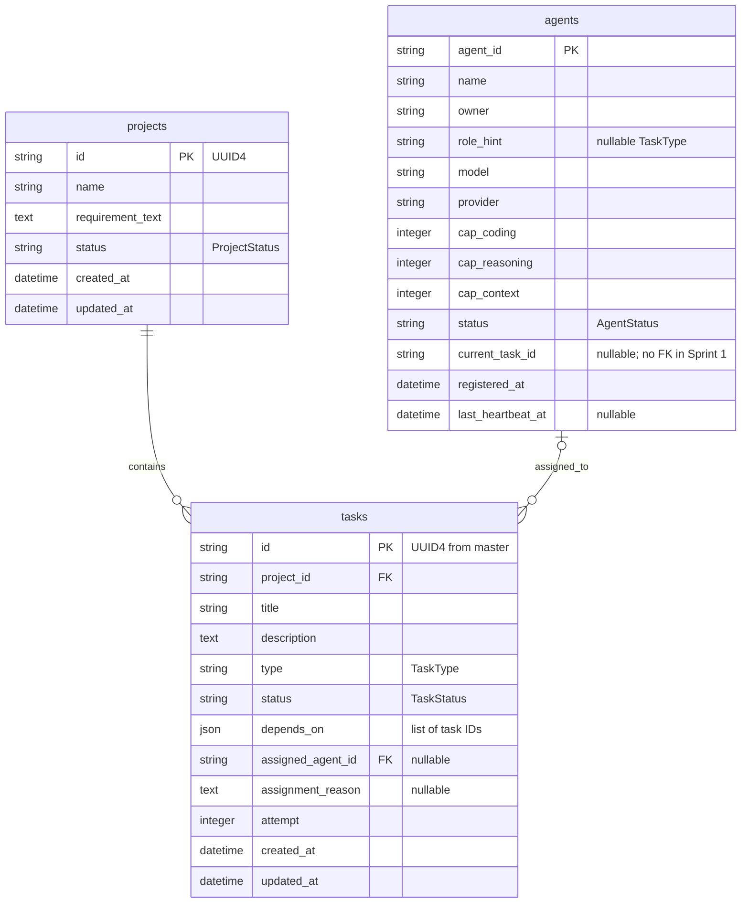

# Platform database (S1-09)

Owner: Can. Implementation: `dap/master/db/`.

This database stores platform agents, projects and tasks. It does not store
books or other business data belonging to an application generated by workers.
The binding field names and function signatures are in
`contracts/PROJECT_CONTRACT.md`.

## Connection and lifecycle

The master reads `DATABASE_URL` through `dap.master.config.get_settings()`.
The current default is `sqlite:///./data/dap.db`. SQLite stores records in this
local file; it does not need PostgreSQL, Docker or a separate server process.
The SQLite parent directory is created automatically when missing.

Importing `dap.master.db.repositories` calls `init_db()` once. Missing tables
are created, existing tables and records are kept. Each repository call opens
and closes its own SQLAlchemy session. Successful writes commit; failed writes
roll back. Callers receive the shared Pydantic models, never ORM records.

Changing `DATABASE_URL` requires restarting the Python process. `data/` and
`.env` are excluded from Git. `create_all()` initializes new databases; it does
not migrate existing table definitions.

## Tables and relationships



SQLite foreign keys are enabled on every connection. Each task belongs to an
existing project and can refer to an existing agent. `depends_on` is JSON as
required by the contract; its IDs are not SQL foreign keys. Dependency graph
validation belongs to the master, not these persistence functions.

Enum columns store the lowercase values from `dap/shared/enums.py`. Database
CHECK constraints reject unknown values even in direct SQL. Capability scores
are limited to 0-100 and `attempt` cannot be negative. Dates are UTC; SQLite
drops timezone metadata, which the repository restores in returned models.

## Repository interface

### Agents

| Function | Result |
| --- | --- |
| `upsert_agent(data)` | Creates or refreshes an `Agent`; no duplicate `agent_id` |
| `get_agent(agent_id)` | `Agent`, or `None` when missing |
| `list_agents()` | Agents ordered by `agent_id` |
| `touch_heartbeat(agent_id, status, current_task_id)` | Updates state and heartbeat; `False` when missing |
| `mark_stale_agents_offline(timeout_sec)` | Number of agents newly marked offline |

Re-registering preserves the first `registered_at`, updates registration
metadata and heartbeat, and resets status to `idle` and `current_task_id` to
null. Stale detection checks the latest heartbeat, or registration time when
there has been no heartbeat. Already-offline agents are not counted again.

### Projects and tasks

| Function | Result |
| --- | --- |
| `create_project(data)` | New `Project`, UUID4 ID, `created` status |
| `get_project(project_id)` | `Project`, or `None` |
| `list_projects()` | Projects ordered by creation time and ID |
| `set_project_status(project_id, status)` | Updates status and `updated_at` |
| `create_tasks(project_id, tasks)` | Stores one batch atomically; initial status `pending` |
| `list_tasks(project_id)` | Project tasks ordered by creation time and ID |
| `get_task(task_id)` | `Task`, or `None` |
| `assign_task(task_id, agent_id, reason)` | Sets agent, reason, `assigned` status and `updated_at` |

Writes that require a missing project, task or agent raise `ValueError`.
Duplicate IDs and database constraint violations raise SQLAlchemy exceptions
and roll back the write. Assignment selection belongs to the master's
selector; this package stores the selected agent and reason.

## Example read queries

Run these against the database selected by `DATABASE_URL`:

```sql
-- Registered agents and the latest heartbeat.
SELECT agent_id, name, role_hint, status, last_heartbeat_at
FROM agents
ORDER BY agent_id;

-- Projects and how many tasks each has (including projects without tasks).
SELECT p.id, p.name, p.status, COUNT(t.id) AS task_count
FROM projects AS p
LEFT JOIN tasks AS t ON t.project_id = p.id
GROUP BY p.id, p.name, p.status;

-- Task type/status, assignment and the reason shown by the frontend.
SELECT p.name AS project_name, t.title, t.type, t.status,
       a.name AS agent_name, t.assignment_reason, t.depends_on
FROM tasks AS t
JOIN projects AS p ON p.id = t.project_id
LEFT JOIN agents AS a ON a.agent_id = t.assigned_agent_id
ORDER BY t.created_at, t.id;
```

## Verification

From the repository root:

```powershell
.\.venv\Scripts\python.exe -m pytest tests/test_repositories.py -q
.\.venv\Scripts\python.exe -m pytest -q
```

The test configuration uses `data/test.db`; repository tests also use isolated
temporary databases. Production `data/dap.db` is never opened by these tests.
Persistence is verified with separate writer and reader Python processes
against the same temporary SQLite file.

The master API owner must wire its endpoints to these functions. This package
does not add endpoints, run LLMs or implement the future worker task loop.
`events` and `task_results` are reserved for later sprints by the contract.
